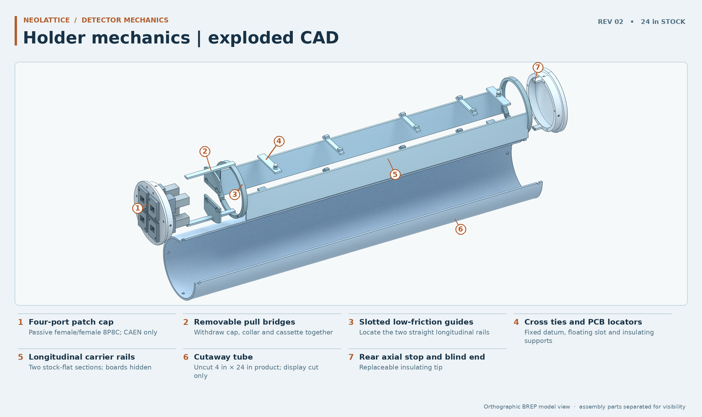

# NanduX Mechanical Designs

Version-controlled mechanical design and manufacturing packages for NanduX hardware.

## Structure

- `mechanical/enclosures/`: electronics and instrument enclosures
- `mechanical/electronics_mounts/`: PCB and electronics mounting hardware
- `mechanical/detector_housings/`: detector and borehole housings
- `mechanical/brackets/`: structural and interface brackets
- `mechanical/assemblies/`: multi-part mechanical assemblies

Each released design documents its purpose, revision, material, process, assumptions, validation status, and manufacturing instructions.

## Mechanical design dashboard

| Design | CAD preview | Current release | Source and drawings | Quote package | Validation |
|---|---|---|---|---|---|
| **[Two 8-channel 5 cm board holder](mechanical/detector_housings/Two_8_Channel_5cm_Board_Holder/README.md)** |  | Rev 02 · 24 in stock 6061-T6 tube, removable dual-board carrier, and four-port rugged CAEN patch panel | [FreeCAD](mechanical/detector_housings/Two_8_Channel_5cm_Board_Holder/cad/Two_8_Channel_5cm_Board_Holder.FCStd) · [Drawings](mechanical/detector_housings/Two_8_Channel_5cm_Board_Holder/drawings/) | [Prototype RFQ ZIP](mechanical/detector_housings/Two_8_Channel_5cm_Board_Holder/quote/Two_8_Channel_5cm_Board_Holder_Rev02_RFQ.zip) | CAD fit checked. First article verifies stock bore, carrier, and installed connectors. |

See [repository conventions](AGENTS.md) for consistent project organization and quote-package checks.
