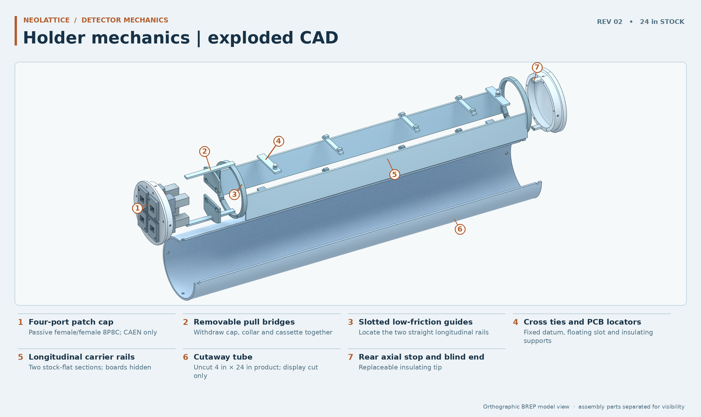

# Two 8-channel 5 cm board holder

**Rev 02** · 24 in stock aluminum tube · removable carrier · four-port CAEN service panel



Two vertically stacked 8-channel, 48.8 mm tile-pitch boards mount on an aligned rail cassette. A fixed round datum and an axial slot use the existing board mounting holes. Two replaceable insulating guide rings center the cassette in a stock tube. The endcap and cassette withdraw together using mechanical pull bridges.

| Feature | Rev 02 |
|---|---|
| Tube | 6061-T6, 4 in OD × 1/8 in wall × 24 in stock. Drill and deburr; no length cut. |
| Bore and slide | Ø95.25 mm nominal bore; Ø93.50 mm minimum clear bore, Ø91.00 mm guide rings and Ø92.50 mm collars |
| Board spacing | 37.00 mm between top planes, set by fixed and slotted cross ties |
| Service panel | Four rugged Neutrik NE8FDP-B-TOP female/female ports on 32 × 36 mm pitch. CAEN detector signals only; no LAN or PoE. |
| Internal leads | Four short jumpers with right-angle exits at the board and a max mated profile of 28 mm from board top |
| Controls | 3.60 × 8.60 mm floating slot; target carrier straightness ≤0.60 mm over 495 mm |

## CAD and drawings

- [FreeCAD assembly](cad/Two_8_Channel_5cm_Board_Holder.FCStd) · [assembled STEP](cad/Mechanical_Only.step) · [exploded STEP](cad/Mechanical_Exploded_View.step)
- [Tube](cad/Tube.step) · [carrier](cad/Carrier_Assembly.step) · [service end](cad/Service_Endcap_Assembly.step) · [blind end](cad/Blind_End_Assembly.step)
- M-01 General arrangement: [printable A3 SVG](drawings/01_Assembly_General_Arrangement.svg) · [PNG](drawings/01_Assembly_General_Arrangement.png)
- M-02 Sections and service end: [printable A3 SVG](drawings/02_Sections_and_Service_End.svg) · [PNG](drawings/02_Sections_and_Service_End.png)

Mechanical CAD omits populated boards and harnesses. Rebuild it using Python 3.12 and CadQuery 2.7:

```bash
pip install -r source/requirements.txt
python source/holder.py --output holder_build
python source/exploded.py --output holder_build
```

The [parametric source](source/holder.py) includes simplified interface envelopes for validation and omits them from STEP exports. The FreeCAD file preserves editable mechanical solids; full dimensions are driven from the CadQuery source.

## Prototype RFQ

**[Download Rev 02 RFQ ZIP](quote/Two_8_Channel_5cm_Board_Holder_Rev02_RFQ.zip)**

[Quote brief](quote/START_HERE.txt) · [per-set parts and BOM](quote/PARTS_AND_BOM.csv) · [RFQ interface drawing](quote/RFQ_Interfaces.svg)

The ZIP contains individual STEP files for 17 cataloged mechanical parts, the respective quantities and materials, the common assembly drawing and instructions for prototype pricing. Ask for standard tube stock with end-drilling only and separate a parts kit price from carrier assembly/joining.

## Validation

[CAD fit checks](verification/fit_check.json) · [reproducible envelope checks](verification/envelope_fit_check.json). The solid checks found no modeled shell or panel/collar interference. At minimum bore, the guide ring leaves 1.25 mm radial clearance and the collar leaves 0.50 mm. The front end uses the [Neutrik NE8FDP-B-TOP manufacturer drawing](https://www.neutrik.com/media/17217/download/20004014_-_NE8FDP-B-TOP.pdf?v=3). On the first article, check actual stock bore, fit with the board stack installed, connector clearance and swing, cable strain relief, and continuity before connecting CAEN.
